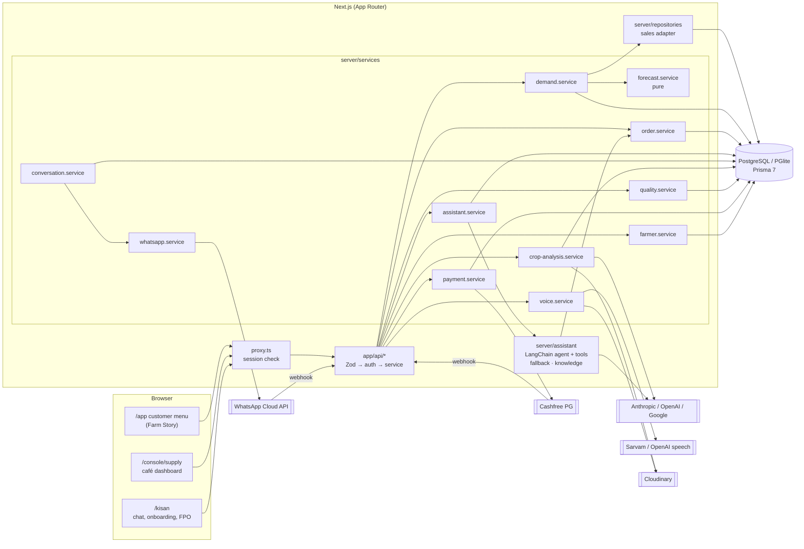
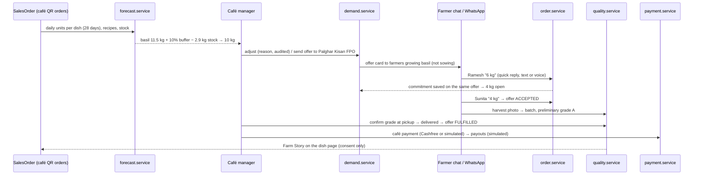
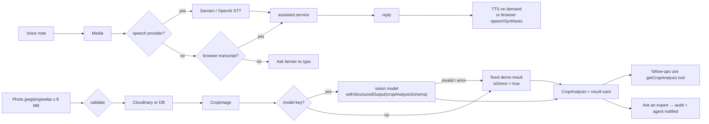
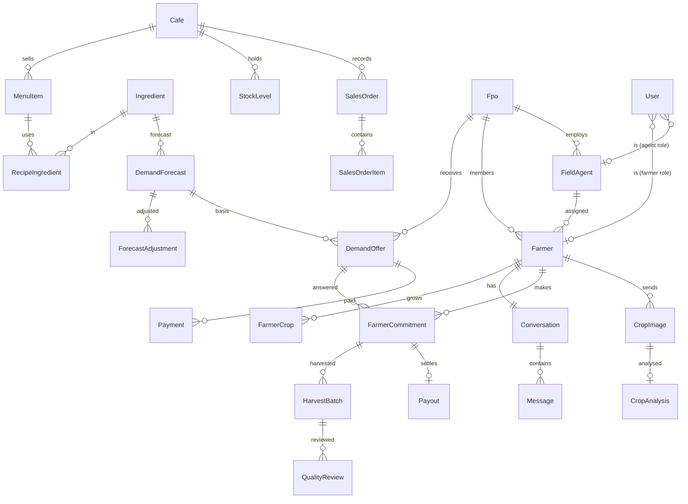

# Architecture

Kisan Sahayak is a module inside the Coffee on QR Next.js app — one codebase, one design system, one database. It is a modular monolith with clear service boundaries, not microservices.

## System

## Modules

| Module | Responsibility | Key files |
|---|---|---|
| Forecast | Pure 7-day ingredient forecast from daily sales × recipes | `server/services/forecast.service.ts` |
| Demand | Supply overview, adjustments (audited), sending offers to an FPO | `server/services/demand.service.ts` |
| Orders | Farmer answers → one commitment per farmer per offer, idempotent, row-locked | `server/services/order.service.ts` |
| Assistant | LangChain `createAgent` with 8 business tools and Zod structured output; deterministic fallback without keys | `server/assistant/*`, `server/services/assistant.service.ts` |
| Conversations | Message storage; outbound via WhatsApp only when configured | `server/services/conversation.service.ts` |
| Crop photos | Validation, storage, vision model with Zod schema, demo result without keys | `server/services/crop-analysis.service.ts`, `media.service.ts` |
| Voice | MediaRecorder → upload → STT → assistant → TTS, `SpeechProvider` interface | `server/services/voice.service.ts`, `server/integrations/speech` |
| Quality | Harvest batches, preliminary visual grade, human review, pickup/delivery, Farm Story | `server/services/quality.service.ts` |
| Payments | Cashfree PG orders + verification + webhook; simulated fallback; simulated payouts | `server/services/payment.service.ts`, `server/integrations/cashfree` |
| WhatsApp | Webhook verify/signature, inbound text/image/audio, statuses, dedupe | `server/services/whatsapp.service.ts`, `server/integrations/whatsapp` |
| Farmers | Onboarding, profiles, FPO overview, agents | `server/services/farmer.service.ts` |
| Auth | JWT session cookie, roles, row-level scopes | `server/auth/*`, `proxy.ts` |

## Café sales → forecast → offer → commitment → batch → payment

Forecast method: 14-day moving average per dish × trend (7d/14d, clamped 0.9–1.1) × weekday index (28 days); ingredient need = Σ units × grams ÷ 1000; buffer 10% (perishables); suggested = max(0, need + buffer − stock) rounded up to 0.5 kg. Every row has a "How this was calculated" panel with per-dish contributions.

Offer states: `DRAFT → OFFERED → PARTIALLY_COMMITTED → ACCEPTED → FULFILLED`, or `CANCELLED`. Commitments are capped at the open quantity; repeats update the same row; idempotency keys and webhook ids are stored in `WebhookEvent`.

## AI image and voice flow

## WhatsApp webhook

`GET /api/webhooks/whatsapp` echoes `hub.challenge` when `hub.verify_token` matches. `POST` verifies `X-Hub-Signature-256` (HMAC-SHA256 of the raw body with the app secret), returns 200 at once and processes in `after()`: each message/status id is claimed in `WebhookEvent` (unique), phone → farmer → conversation; text → assistant, image → crop analysis, audio → voice; statuses update `Message.status` without downgrading. Outbound replies go through the Graph API only when credentials exist; otherwise they stay in the portal under a "Demo conversation" chip.

## Cashfree lifecycle

Create order (server) → `payment_session_id` → hosted checkout → return URL triggers a server-side `GET /orders/{id}` check → `PAID / FAILED / CANCELLED / PENDING`. The webhook (signature over timestamp + raw body) is idempotent and `PAID` is terminal. A redirect never marks anything paid. Café collection is separate from farmer payouts, which are recorded as simulated.

## Data model

Also: `Media` (bytes or Cloudinary id), `WebhookEvent` (dedupe ledger), `AuditLog`.

## Access control

Enforced in services, not only the UI (`server/auth/access.ts`, tests in `tests/integration/access-control.test.ts`):

| Role | Sees | Can do |
|---|---|---|
| Admin | everything | everything, integrations page |
| Café manager | forecasts, offers, aggregate commitments, batches, payments | adjust, send/cancel offers, review grades, payments — not farmer private records |
| FPO manager | farmers, offers, batches of own FPO | register/edit farmers, answer for farmers, review grades |
| Field agent | own assigned farmers only | register farmers (to self), chat on their behalf |
| Farmer | own profile, chat, offers, payments | answer offers, send photos/voice, log harvests |

`proxy.ts` redirects signed-out users; `requirePage` checks the role per page; every API route calls `requireActor(roles)`; services apply row scopes (`farmerScope`, `offerScope`, `assertFarmerAccess`).

## Real vs simulated

| Path | Without keys | With keys |
|---|---|---|
| Database | Embedded PGlite (demo only) | PostgreSQL |
| Assistant | Rule-based, "Demo reply" | LangChain agent + tools |
| Crop photo | Fixed example, "Demo analysis" | Vision model, Zod-validated |
| Harvest grade | Demo grade A | Vision model grade |
| Speech | Browser Web Speech where supported | Sarvam / OpenAI |
| Images | Database | Cloudinary |
| WhatsApp | Portal only, "Demo conversation" | Cloud API send + webhook |
| Café payment | Simulated, labelled | Cashfree PG (sandbox first) |
| Farmer payout | Simulated, audit says no money moved | Not implemented |
| Sensors on farm batches | "No sensor attached" | — (café Thermal Debt starts on arrival) |
